# Stribog

**A calm, honest control room for MikroTik home networks.**

Stribog signs in to your RouterOS router with the same user and password as WinBox or WebFig and shows, in plain English, what is on your network, where it is connected, how the internet is doing and what in the setup is worth fixing. It changes nothing on the router unless you ask it to and confirm.

<picture>
  <source media="(prefers-color-scheme: dark)" srcset="docs/screenshots/dark/hero.jpg">
  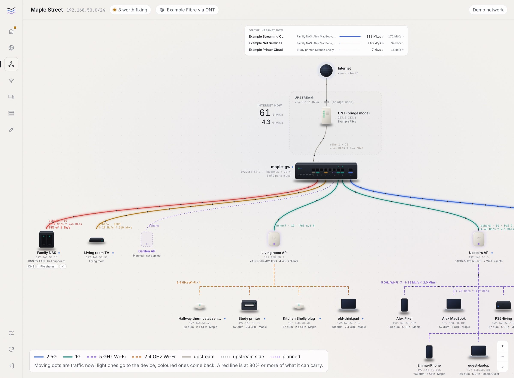
</picture>

<sub>All screenshots show the built-in demo network, "Maple Street". It is fictional: try it without a router. Stribog has a light and a dark theme; the screenshots follow yours.</sub>

```sh
pnpm install && pnpm dev    # open http://127.0.0.1:4517 and pick "Explore the demo network"
```

[What it shows](#what-it-shows) · [Safe by design](#safe-by-design) · [Quick start](#quick-start) · [Agents (MCP)](#agents-mcp) · [Licence](#licence)

## What it shows

### The whole network on one map

<picture>
  <source media="(prefers-color-scheme: dark)" srcset="docs/screenshots/dark/topology.jpg">
  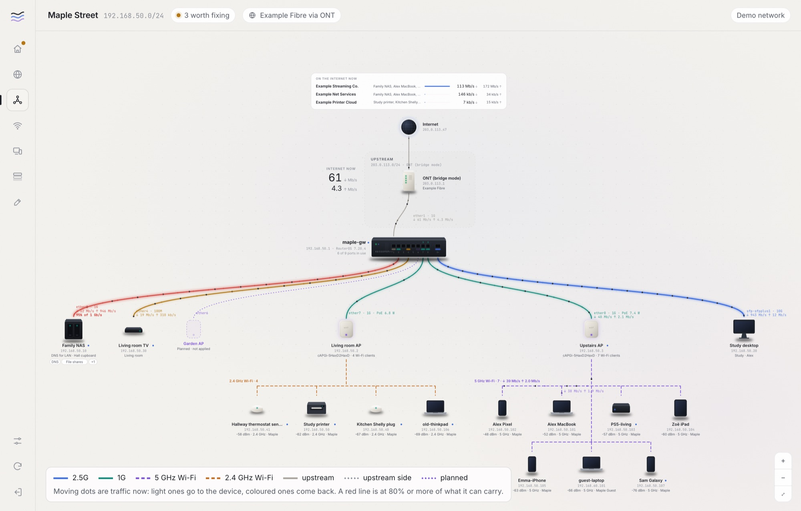
</picture>

The map draws the actual kinds of hardware, wired and Wi-Fi alike. Cables are solid and coloured by link speed, Wi-Fi links are dashed in their band's colour, port LEDs show link speed and PoE is marked. Devices behind an access point sit under it in one cluster per medium (cable, 2.4 GHz, 5 GHz), strongest signal first.

Moving dots are traffic right now. A link at 80% or more of what it can carry turns red and says how full it is (in the demo, the study desktop on the router's 10G port is copying files from the NAS, so the NAS's 1G cable is full): a cable against its speed, a Wi-Fi device against roughly 60% of its link rate (an estimate). While Stribog records, it notes every minute a link is at its limit, and links that were often full in the last week show in the review, so you know which parts to make faster. The box above the internet lists who the whole network is talking to right now, by network owner (Google, Cloudflare, Amazon…), with the rate each way and the devices behind it.

### Home: is everything working?

<picture>
  <source media="(prefers-color-scheme: dark)" srcset="docs/screenshots/dark/home.jpg">
  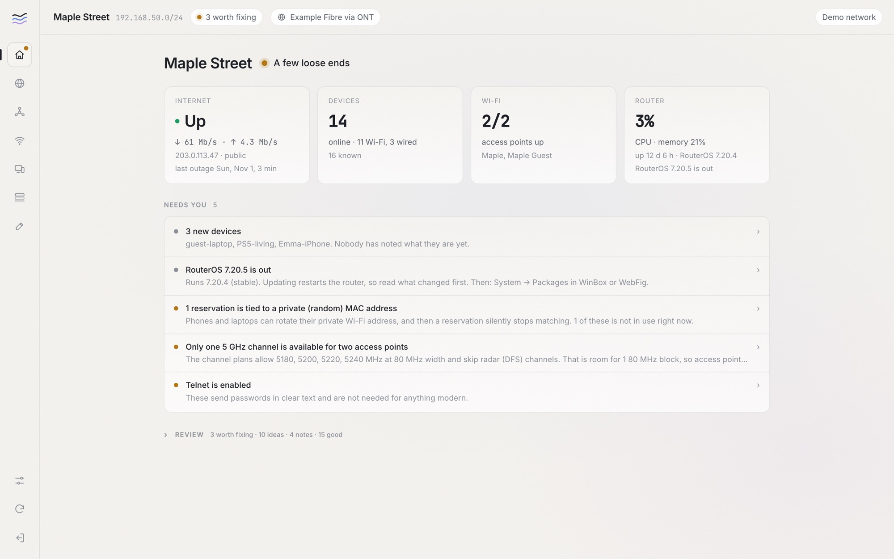
</picture>

Internet and traffic now, devices online, access points up and the router's load, then what needs you: problems right now, devices nobody has said anything about yet, a newer RouterOS.

- **New devices.** Stribog keeps when it first saw each device online. After a first week of learning the network, a device that turns up is marked new until someone says what it is (any note, a reservation on the router, or **I know this device**). A device on a private (random) address may be a known one that changed its address, and Stribog says so.
- **Updates.** Once a day Stribog asks the router to check MikroTik's server for a newer RouterOS on its channel (`/system/package/update/check-for-updates`: it changes no settings and downloads nothing), and says when the firmware (RouterBOOT) is behind. Updating stays in WinBox or WebFig, because it restarts the router.

### Where the traffic goes

<picture>
  <source media="(prefers-color-scheme: dark)" srcset="docs/screenshots/dark/world.jpg">
  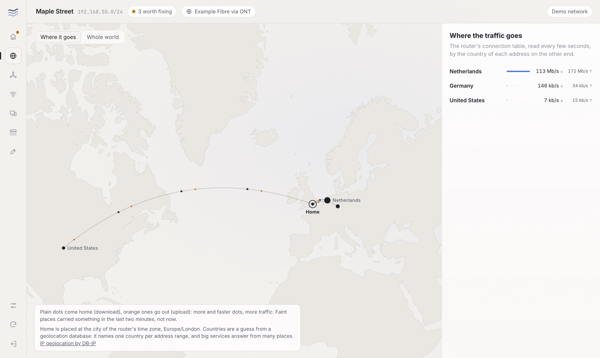
</picture>

The same traffic on a world map: an arc from home to each country the network is talking to, with dots moving along it (plain ones coming home, orange ones going out; more and faster dots for more traffic). Click a country for who runs the addresses there and which devices talk to them. Countries come from DB-IP's free country database ([IP geolocation by DB-IP](https://db-ip.com), CC BY 4.0, about 5 MB, downloaded every two weeks and searched offline). It is a guess: it names one country per address range, and big services answer from many places. Home is placed at the city of the router's time zone.

### Is it me or my provider?

<picture>
  <source media="(prefers-color-scheme: dark)" srcset="docs/screenshots/dark/internet.jpg">
  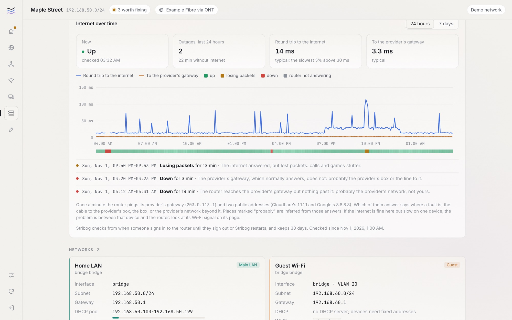
</picture>

Once a minute the router pings its provider's gateway and two public addresses (Cloudflare's 1.1.1.1 and Google's 8.8.8.8). Stribog shows the last day or week: round trips, every minute up, losing packets or down, and each outage with where it probably stopped (the cable to the provider's box, no address from the provider, the provider's box, or the provider's network beyond it).

### Every device, up close

<picture>
  <source media="(prefers-color-scheme: dark)" srcset="docs/screenshots/dark/device.jpg">
  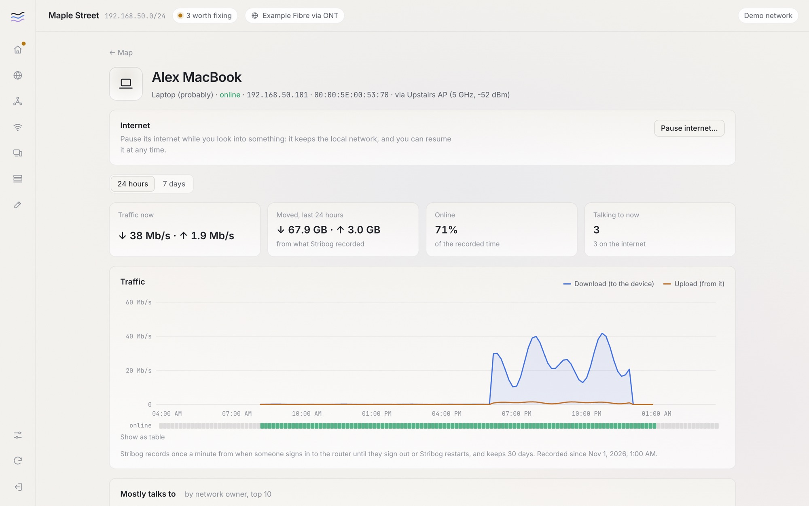
</picture>

Traffic over time and when it was online, who it is talking to now and over the last day or week (by network owner, with ports, bytes each way and the names the router's DNS knows), the maker of its network chip, and your notes: its name, kind, room, owner and the services it runs. When something looks off, **Pause internet** cuts it off the internet but keeps the local network, until you resume it.

### Wi-Fi

<p>
<picture>
  <source media="(prefers-color-scheme: dark)" srcset="docs/screenshots/dark/wifi.jpg">
  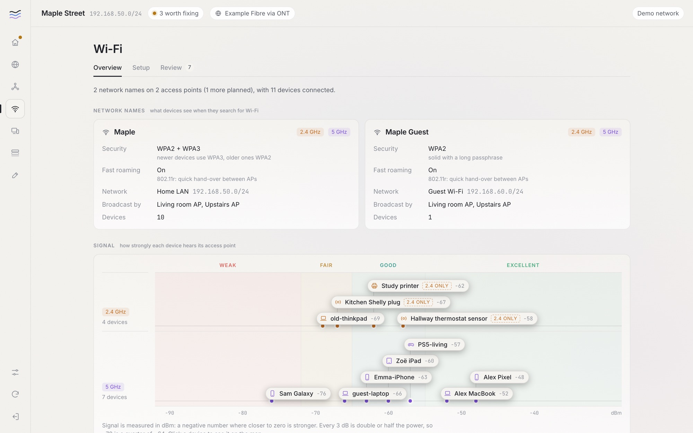
</picture>
<picture>
  <source media="(prefers-color-scheme: dark)" srcset="docs/screenshots/dark/wifi-channels.jpg">
  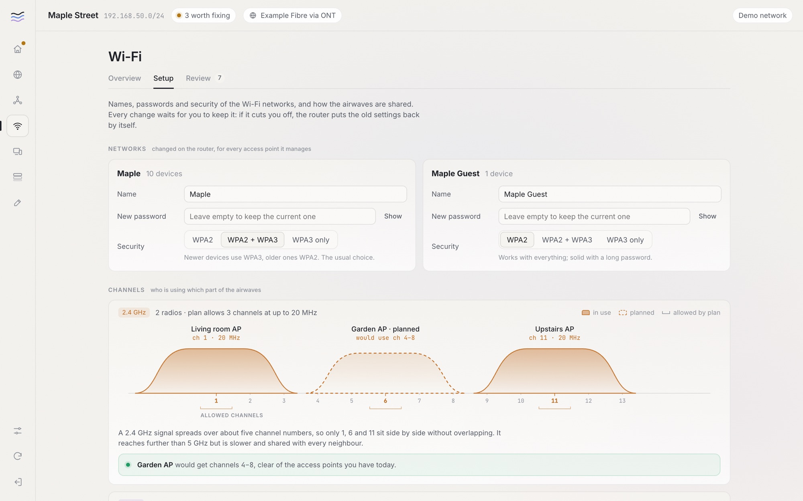
</picture>
</p>

The networks, every client on a signal scale and the access points; a channel map per band, including where a planned access point would go. Change a network's name, password or security (WPA2, WPA2 + WPA3, WPA3) from Stribog: before anything changes, it puts a scheduler entry on the router that restores the old settings after 2½ minutes, so if the change cuts you off, the router undoes it on its own. Once you are back on the Wi-Fi, you **Keep** it. Stribog never reads the old password and never stores the new one.

### A review, not a score

<picture>
  <source media="(prefers-color-scheme: dark)" srcset="docs/screenshots/dark/review.jpg">
  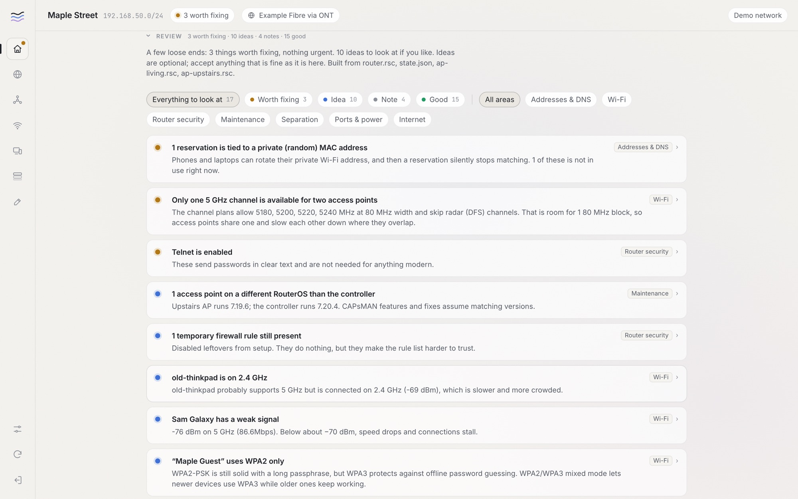
</picture>

How the network is set up, what is solid and what is fragile. Every finding explains why it matters in plain words, with the evidence, and says where the setup stands in words (healthy, a few loose ends, needs attention) rather than as a number. A finding that is fine on your network can be **accepted** with a reason: it stops counting until something changes. The review only diagnoses; how to fix something depends on the rest of your network, so each finding hands an AI agent a request with the configuration involved (see [Agents](#agents-mcp)).

### Changes you can read first

<picture>
  <source media="(prefers-color-scheme: dark)" srcset="docs/screenshots/dark/change.jpg">
  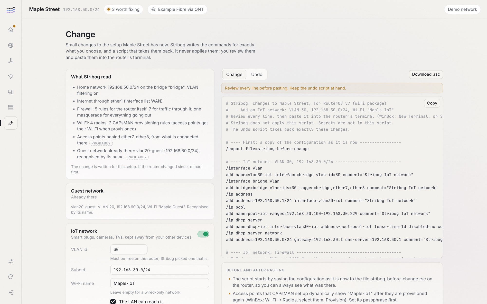
</picture>

Add a guest or IoT network, rename the Wi-Fi, change its security or 5 GHz channels: Stribog shows what it read about your setup (inferences marked as such) and writes the commands for exactly what you chose, plus a script that undoes them. You review and paste them yourself. **New setup** (in Settings) generates a clean, opinionated configuration for a router reset with no configuration.

<details><summary>And the rest: clients, LAN & internet</summary>

<picture>
  <source media="(prefers-color-scheme: dark)" srcset="docs/screenshots/dark/clients.jpg">
  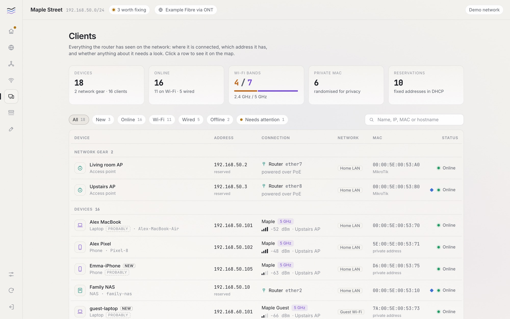
</picture>

**Clients** lists everything the router has seen, where it is connected, reservations that no longer match and devices Stribog is unsure about. **LAN & internet** shows the internet path (double NAT shows as two hops), networks and DHCP, an address map, the router's ports, management services, and the firewall in plain language.

</details>

## Safe by design

- **Your router password stays in memory.** Stribog has no accounts of its own: you sign in with the router's user, and Stribog keeps the credentials in server memory for the session only, never on disk, in logs or in the browser.
- **It writes to the router only twice**, and only when a person signed in to Stribog confirms: pausing a device's internet and the Wi-Fi settings. Each shows the exact change first, is read back from the router to check it, and is undone if the check fails; the Wi-Fi change also has the timed undo above. Everything else is a script for you to review. Every change is logged in Settings → History.
- **It says what it does not know.** Everything comes from the router or from notes people write. Inferences are marked "probably", and estimates say so.
- **Your traffic stays home.** Network owners, countries and network-chip makers come from public databases (iptoasn.com, DB-IP, the IEEE registry) that Stribog downloads and searches offline. The only other site it contacts is rdap.org, when you click **Who is this?** on an address. `STRIBOG_NO_DOWNLOADS=1` keeps it off the internet entirely.

## Quick start

Requires Node 26+ (the current LTS; `nvm use` picks it up from `.nvmrc`) and pnpm.

```sh
pnpm install
pnpm dev            # http://127.0.0.1:4517
```

Open it and sign in to your router, or pick the demo network.

### Signing in

Stribog fills in this computer's gateway as the router address and `admin` as the user. Use the password you use for WinBox or WebFig; a router that was never set up has it on the label underneath. Stribog keeps the user and password in memory while you are signed in and never writes them to disk.

It talks to the router's REST API, which RouterOS 7.9 and newer serve from the same web service as WebFig. It tries https (`www-ssl`) first and accepts the router's self-signed certificate, then falls back to plain http (`www`). Over http the password crosses your network unencrypted on every read, and Stribog says so in the top bar; turning on `www-ssl` fixes it.

To pin the address, create `stribog.config.json` in the repository root (it is git-ignored, as is `data/`):

```json
{
  "router": { "url": "192.168.88.1", "interval": 15 }
}
```

`interval` is the number of seconds between reads while the app is open.

For development, `"debug": { "saveSnapshot": "data/live.json" }` writes every live read to that file (secrets scrubbed, mode 600), which is handy for reproducing a problem in a test.

### Your own network, offline

Export the configuration on the router (`/export file=router`, then download `router.rsc`) and do the same on each CAPsMAN access point. Then list them in `stribog.config.json` without a `router` entry; Stribog shows them without asking anyone to sign in:

```json
{
  "sources": [
    { "role": "router", "export": "data/router.rsc" },
    { "role": "cap", "export": "data/ap-living.rsc" }
  ]
}
```

An export has the configuration but no runtime state, so the review works fully while clients, signal and link speeds are missing. A `state` file per source can add runtime data (see `fixtures/demo/state.json` for the shape).

### Notes: what the router cannot know

Everything Stribog shows comes from the router, except notes. Click a device: **Rename** next to its name sets the name and kind; under it you add labels (a room, an owner, a role) and a short description; further down, the services that run on it and free-form notes. Notes show up on the map and everywhere else at once.

Notes, their change history and agent tokens live in Stribog's data directory: `~/.local/share/stribog` on Linux, `~/Library/Application Support/Stribog` on macOS, `%APPDATA%\Stribog` on Windows (or `dataDir` in the config, or `STRIBOG_DATA`). Every change is appended to `audit.jsonl` with before and after, and listed under **Settings → History**.

The same notes are available over HTTP:

| Request | |
|---|---|
| `GET /api/notes` | all notes |
| `GET /api/notes/devices/{mac}` | one device |
| `PATCH /api/notes/devices/{mac}` | change the fields you send; `null` clears one |
| `PUT /api/notes/devices/{mac}` | replace the device's notes |
| `DELETE /api/notes/devices/{mac}` | forget them |
| `PATCH /api/notes/network` | `site`, `upstream` (`name`, `model`, `isp`), `notes` |
| `GET /api/notes/audit` | the change history, newest first |

Device fields: `name`, `kind`, `labels`, `description`, `services` (each `name`, `port`, `protocol`, `url`, `note`), `notes`, `only24` for hardware that only has a 2.4 GHz radio, and two for machines with several connections (cable and Wi-Fi): `sameAs`, the MAC of another connection of the same machine, and `separate: true` for a device that only shares its DHCP name with another. `known: true` says someone knows what a device is, so it is not shown as new. Connections that give the router the same DHCP name are shown as one machine, marked as a guess, unless more than one of them could be Wi-Fi (phones of the same model share names).

### Device details and history

**Details** under a device's name opens its page: traffic over time with when it was online, who it is talking to right now and who it talked to over the last 24 hours or 7 days, with ports, bytes each way and the names the router's DNS cache knows for the other end. It comes from the router's connection tracking (`/ip/firewall/connection`, read only when needed) and DNS cache, so it shows what the router routes: traffic to the internet or between networks, not devices talking to each other on the same LAN. Port names ("usually HTTPS") are conventions, marked as such.

The page also lists who a device mostly talks to, by network owner (Cloudflare, Apple, Google…), top 10, now and over the period: often enough to tell what an unknown device is. Owners come from the free [iptoasn.com](https://iptoasn.com) database (public domain), which Stribog downloads weekly (about 9 MB) into the data directory and searches offline, so the addresses your devices talk to are not sent anywhere for it. Reverse-DNS names come from the system's own resolver. Makers of network interfaces come from the IEEE registry of MAC address prefixes (public data, about 5 MB, downloaded weekly into the data directory and searched offline): the maker of the network chip, which is often a module inside a device rather than its brand, so it is shown as such. `STRIBOG_NO_DOWNLOADS=1` turns off these downloads and the country database's (see **World** above). "Who is this?" next to an address asks the internet registry (RDAP, via rdap.org) about that one address, only when you click it. `STRIBOG_NO_DOWNLOADS=1` keeps Stribog off the internet entirely.

Stribog records once a minute from the first sign-in until someone signs out, the router stops accepting the password, or Stribog restarts, using the credentials it already holds in memory (the browser session itself still ends after 12 idle hours). After a restart nothing is recorded until someone signs in again. History, including the internet check, lives in the data directory under `history/` and is kept for 30 days. A device behind a RouterOS container's veth interface is named after the container.

### Integrations

Other things on your network that know what devices do can be connected in Settings → Integrations. Stribog reads them and shows what they know beside what the router reports; it never changes their settings.

- **AdGuard Home.** Its query log says which names each device looks up. A device's details list the domains it looked up over the period (grouped by registered domain, with what the block lists stopped), and AdGuard's answers name the addresses in its traffic, which the router cannot do when devices ask AdGuard rather than the router. Stribog suggests the DNS servers the router hands out. When there are several (a replica, say), devices split their lookups between them, so connect each one: Stribog reads them as one log, and a device's details say when a server is missing. Like the router's, the AdGuard password stays in memory only: connect again after Stribog restarts. The demo reads a built-in sample log.

### Agents (MCP)

Under **Settings → Agents**, create a token for an AI agent. It is shown once; Stribog keeps only its hash. The agent connects to `http://<stribog>/mcp` (Streamable HTTP) with `Authorization: Bearer <token>`, for example:

```sh
claude mcp add --transport http stribog http://127.0.0.1:4517/mcp --header "Authorization: Bearer stb_…"
```

An agent has the same rights as a person for notes, and sees the network through the most recent signed-in session (or its last read, marked stale, after someone signs out or Stribog restarts). Tools: `get_network_overview`, `list_devices`, `get_device`, `get_device_activity`, `get_internet_health`, `update_device_notes`, `update_network_notes`, `get_review`, `get_fix_request`, `accept_finding`, `reopen_finding`, `get_change_log`. The token also works for the HTTP API above.

Fixes come from the agent, not from Stribog. `get_fix_request` (also the prompt `fix_finding`) gives it one finding with its evidence, the network, the devices involved, your notes, the configuration the check read (secrets hidden) and what a good answer contains: whether it is a real problem here, the options, exact commands that touch only the items involved, how to check and how to undo, and the risk of losing access. In the app, **Copy request for an agent** on a finding copies the same text for an agent that is not connected.

## Command line

```sh
pnpm review                                  # terminal report for ./stribog.config.json (or the demo)
pnpm review -- --details                     # include explanations and evidence
pnpm exec tsx src/cli/stribog.ts advise <id>  # a request for advice on one finding, for an AI agent
pnpm review -- --export router.rsc --cap ap.rsc [--notes notes.json]
pnpm collect -- --url https://192.168.88.1 --user stribog --password-file ~/.config/stribog/router-password --insecure --out data/snapshot.json
```

`collect` reads the router once and saves a snapshot, which can be used as a source with `"snapshot": "data/snapshot.json"`. It only issues `GET` requests and `monitor … once` reads, so a read-only user is enough:

```
/user group add name=stribog-read policy=read,api,rest-api
/user add name=stribog group=stribog-read password="<long random password>"
```

The password comes from `--password-file` or `STRIBOG_PASSWORD`. `--insecure` accepts the router's self-signed certificate.

## Production

```sh
pnpm build && pnpm start      # serves dist/ and /api on 127.0.0.1:4517 (HOST/PORT to change)
```

Or in Docker, on an always-on machine at home:

```sh
mkdir -p data/docker/config data/docker/data
echo '{ "router": { "url": "192.168.88.1" } }' > data/docker/config/stribog.config.json
docker compose up -d --build  # http://127.0.0.1:4517
```

A container cannot see your network's gateway, so the config names the router. `STRIBOG_HOME` moves the `config` and `data` folders elsewhere, and `STRIBOG_BIND` changes where it listens. `/healthz` answers without signing in.

Stribog has no accounts of its own: signing in means signing in to the router. The Stribog server itself speaks plain http, so if you open it from another machine the password travels from your browser to Stribog unencrypted. Keep it on localhost, or put it behind https on the LAN or a VPN.

## How it works

- `src/core/ros.ts` parses `/export` scripts (line continuations, quoting, `\XX` escapes, `set [ find … ]`) into the same shape the REST API returns, and hides secrets.
- `src/core/model.ts` builds one model of devices, ports, networks, SSIDs, radios and the WAN. Every derived fact records whether it was read, inferred or told by the user, and the UI says "probably" for inferences.
- `src/core/analyze.ts` holds the review rules (diagnosis only; each finding notes the configuration it read) and `src/core/advice.ts` turns a finding into a request for advice. `src/core/layout.ts` lays out the topology (port order left to right, so links never cross). `src/core/setup.ts` generates setup scripts, `src/core/change.ts` writes changes (and their undo) for a router that is already set up, and `src/core/firewall.ts` describes rules in plain language.
- `src/core/rest.ts` reads the router over REST. `src/server/session.ts` signs in and keeps sessions in memory. `src/server/provider.ts` picks the source: the signed-in router, files, or the demo.
- `src/server/notes.ts` keeps notes and the change log, `src/server/tokens.ts` agent tokens, `src/server/mcp.ts` the MCP tools.
- `src/core/activity.ts` turns the connection table into who-talks-to-whom; `src/server/owners.ts` looks up network owners, reverse DNS and RDAP; `src/server/recorder.ts` and `src/server/history.ts` record and keep history.
- `src/web` is the React app. `src/server` serves `/api`.

```sh
pnpm test        # vitest
pnpm typecheck
```

## Status

Early. Signing in and reading live are tested against a mocked router; the first runs on real hardware are under way. The only changes Stribog makes to the router itself are pausing a device and the Wi-Fi settings, each shown in full and confirmed first; everything else is a script for you to review. The setup generator follows RouterOS v7 syntax but should be tried on a spare or freshly reset router before being trusted.

## Licence

[MIT](LICENSE).
