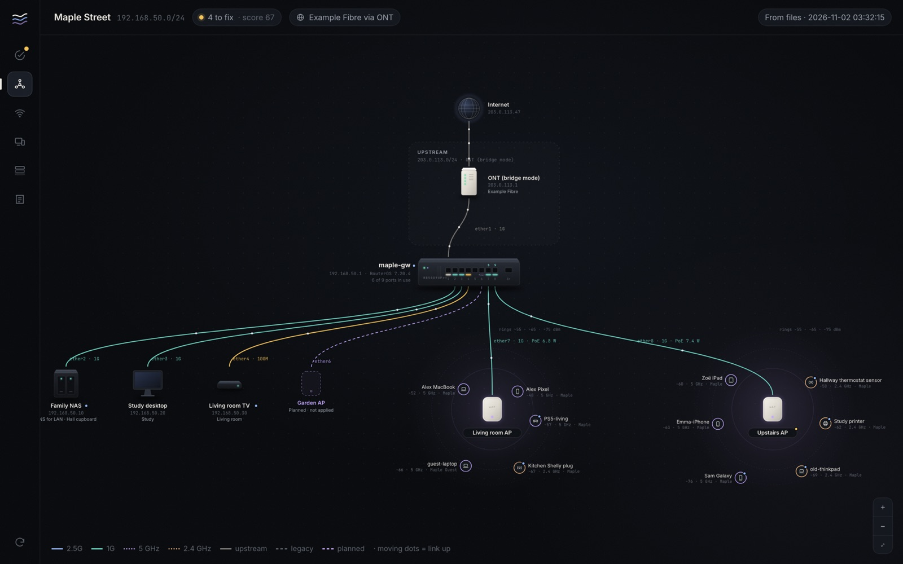
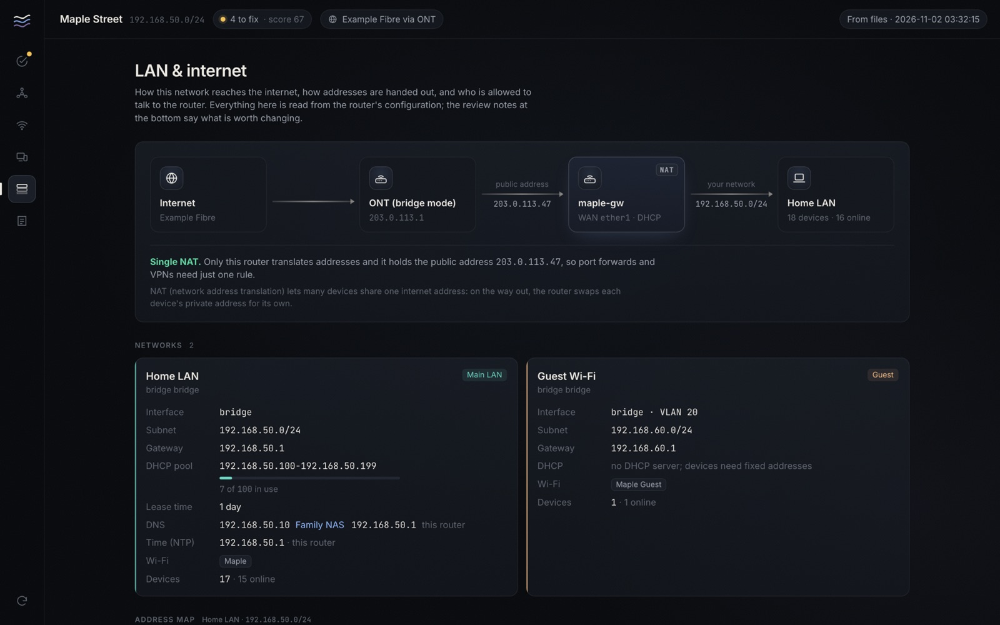

# Stribog

A calm, honest control room for MikroTik home networks.

Stribog signs in to a RouterOS router with the same user and password as WinBox or WebFig (or reads `/export` files) and shows you:

- **Review**: how the network is set up, what is solid, what is fragile, and exactly what to change. Every finding explains why it matters in plain words and, where the fix is on the router, gives a RouterOS script to review.
- **Topology**: a tidy map with drawings of the actual kinds of hardware. Port LEDs show link speed, PoE is marked, planned devices are dashed, and Wi-Fi clients orbit their access point at a distance set by signal strength.
- **Wi-Fi**: networks, a channel map per band (including where a planned access point would have to go), and every client on a signal scale.
- **Clients**: everything the router has seen, where it is connected, reservations that no longer match, and devices Stribog is unsure about.
- **LAN & internet**: the internet path (double NAT shows as two NAT hops), networks and DHCP, an address map of the LAN, the router's ports, management services, and the firewall in plain language.
- **Setup & fix plan**: a combined fix script for the findings you pick, and a generator for a clean, opinionated home or small-office setup.

Stribog never changes anything on the router. Scripts are for you to read and paste.




<details><summary>More screens</summary>





</details>

Screenshots show the built-in fictional demo network (`fixtures/demo`).

## Quick start

Requires Node 22+ and pnpm.

```sh
pnpm install
pnpm dev            # http://127.0.0.1:4517
```

Open it and sign in to your router, or pick the demo network.

### Signing in

Stribog fills in this computer's gateway as the router address and `admin` as the user. Use the password you use for WinBox or WebFig; a router that was never set up has it on the label underneath. Stribog keeps the user and password in memory while you are signed in and never writes them to disk.

It talks to the router's REST API, which RouterOS 7.9 and newer serve from the same web service as WebFig. It tries https (`www-ssl`) first and accepts the router's self-signed certificate, then falls back to plain http (`www`). Over http the password crosses your network unencrypted on every read, and Stribog says so in the top bar; turning on `www-ssl` fixes it.

To pin the address, create `stribog.config.json` in the repository root (it is git-ignored, as is `data/`):

```json
{
  "router": { "url": "192.168.88.1", "interval": 15 },
}
```

`interval` is the number of seconds between reads while the app is open.

For development, `"debug": { "saveSnapshot": "data/live.json" }` writes every live read to that file (secrets scrubbed, mode 600), which is handy for reproducing a problem in a test.

### Your own network, offline

Export the configuration on the router (`/export file=router`, then download `router.rsc`) and do the same on each CAPsMAN access point. Then list them in `stribog.config.json` without a `router` entry; Stribog shows them without asking anyone to sign in:

```json
{
  "sources": [
    { "role": "router", "export": "data/router.rsc" },
    { "role": "cap", "export": "data/ap-living.rsc" }
  ]
}
```

An export has the configuration but no runtime state, so the review works fully while clients, signal and link speeds are missing. A `state` file per source can add runtime data (see `fixtures/demo/state.json` for the shape).

### Notes: what the router cannot know

Everything Stribog shows comes from the router, except notes. Click a device and use **Notes** to give it a name, a kind, labels (a room, an owner, a role), a short description, the services that run on it, and free-form notes. Notes show up on the map and everywhere else at once.

Notes, their change history and agent tokens live in Stribog's data directory: `~/.local/share/stribog` on Linux, `~/Library/Application Support/Stribog` on macOS, `%APPDATA%\Stribog` on Windows (or `dataDir` in the config, or `STRIBOG_DATA`). Every change is appended to `audit.jsonl` with before and after, and listed under **Settings → History**.

The same notes are available over HTTP:

| Request | |
|---|---|
| `GET /api/notes` | all notes |
| `GET /api/notes/devices/{mac}` | one device |
| `PATCH /api/notes/devices/{mac}` | change the fields you send; `null` clears one |
| `PUT /api/notes/devices/{mac}` | replace the device's notes |
| `DELETE /api/notes/devices/{mac}` | forget them |
| `PATCH /api/notes/network` | `site`, `upstream` (`name`, `model`, `isp`), `notes` |
| `GET /api/notes/audit` | the change history, newest first |

Device fields: `name`, `kind`, `labels`, `description`, `services` (each `name`, `port`, `protocol`, `url`, `note`), `notes`, and `only24` for hardware that only has a 2.4 GHz radio.

### Agents (MCP)

Under **Settings → Agents**, create a token for an AI agent. It is shown once; Stribog keeps only its hash. The agent connects to `http://<stribog>/mcp` (Streamable HTTP) with `Authorization: Bearer <token>`, for example:

```sh
claude mcp add --transport http stribog http://127.0.0.1:4517/mcp --header "Authorization: Bearer stb_…"
```

An agent has the same rights as a person for notes, and sees the network through the most recent signed-in session (or its last read, marked stale, when nobody is signed in). Tools: `get_network_overview`, `list_devices`, `get_device`, `update_device_notes`, `update_network_notes`, `get_review`, `get_change_log`. The token also works for the HTTP API above.

## Command line

```sh
pnpm review                                  # terminal report for ./stribog.config.json (or the demo)
pnpm review -- --fix                         # include evidence and fix scripts
pnpm review -- --export router.rsc --cap ap.rsc [--notes notes.json]
pnpm collect -- --url https://192.168.88.1 --user stribog --password-file ~/.config/stribog/router-password --insecure --out data/snapshot.json
```

`collect` reads the router once and saves a snapshot, which can be used as a source with `"snapshot": "data/snapshot.json"`. It only issues `GET` requests and `monitor … once` reads, so a read-only user is enough:

```
/user group add name=stribog-read policy=read,api,rest-api
/user add name=stribog group=stribog-read password="<long random password>"
```

The password comes from `--password-file` or `STRIBOG_PASSWORD`. `--insecure` accepts the router's self-signed certificate.

## Production

```sh
pnpm build && pnpm start      # serves dist/ and /api on 127.0.0.1:4517 (HOST/PORT to change)
```

Stribog has no accounts of its own: signing in means signing in to the router. The Stribog server itself speaks plain http, so if you open it from another machine the password travels from your browser to Stribog unencrypted. Keep it on localhost, or put it behind https on the LAN or a VPN.

## How it works

- `src/core/ros.ts` parses `/export` scripts (line continuations, quoting, `\XX` escapes, `set [ find … ]`) into the same shape the REST API returns, and hides secrets.
- `src/core/model.ts` builds one model of devices, ports, networks, SSIDs, radios and the WAN. Every derived fact records whether it was read, inferred or told by the user, and the UI says "probably" for inferences.
- `src/core/analyze.ts` holds the review rules. `src/core/layout.ts` lays out the topology (port order left to right, so links never cross). `src/core/setup.ts` generates setup scripts, and `src/core/firewall.ts` describes rules in plain language.
- `src/core/rest.ts` reads the router over REST. `src/server/session.ts` signs in and keeps sessions in memory. `src/server/provider.ts` picks the source: the signed-in router, files, or the demo.
- `src/server/notes.ts` keeps notes and the change log, `src/server/tokens.ts` agent tokens, `src/server/mcp.ts` the MCP tools.
- `src/web` is the React app. `src/server` serves `/api`.

```sh
pnpm test        # vitest
pnpm typecheck
```

## Status

Early. Signing in and reading live are tested against a mocked router; the first runs on real hardware are under way. Stribog does not change anything on the router yet: changes are planned, each shown in full and confirmed before it is applied. The setup generator follows RouterOS v7 syntax but should be tried on a spare or freshly reset router before being trusted.

Licence: not chosen yet.
