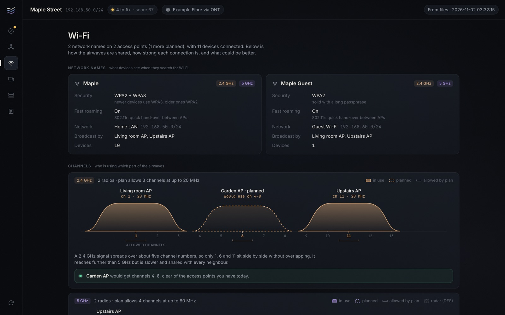
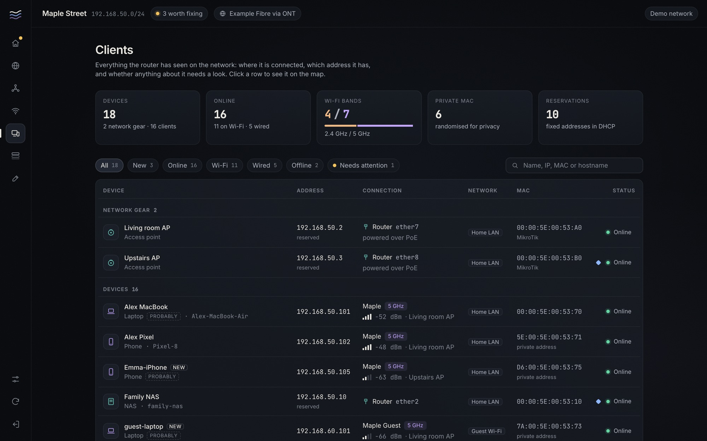
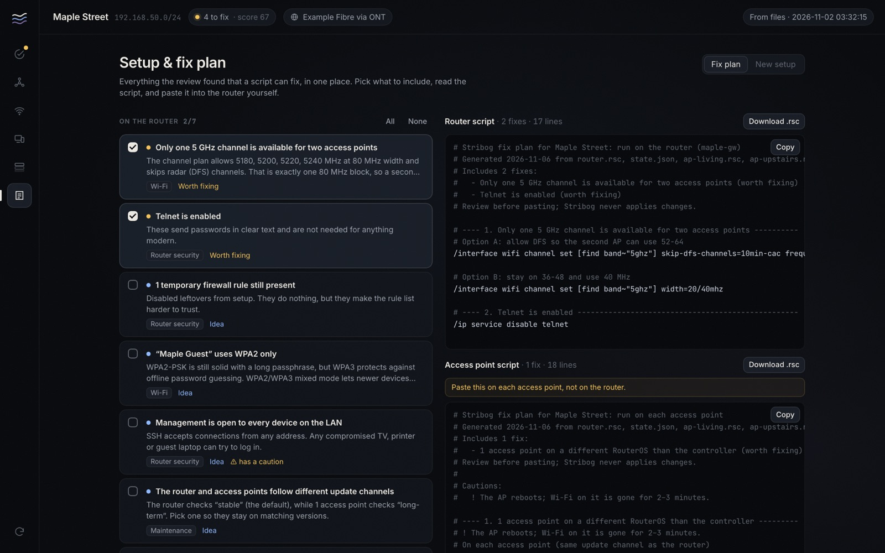

# Stribog

A calm, honest control room for MikroTik home networks.

Stribog signs in to a RouterOS router with the same user and password as WinBox or WebFig (or reads `/export` files) and shows you:

- **Home**: is the network working (internet and traffic now, devices online, access points up, the router's load) and what needs you: problems right now and what the review says is worth fixing. The full review sits folded below; click to open it.
- **On the internet now**: a box above the Internet on the map lists who the whole network is talking to on the internet right now, by network owner (Google, Cloudflare, Amazon…), with the rate each way and the devices behind it, busiest first. It reads the router's connection table every few seconds (less often when the table is large: about 2 ms per connection) and counts what each connection moved since the last read; owners come from the offline network database.
- **Where the network runs out**: the topology shows what goes to and from the internet right now in big numbers, and draws any link at 80% or more of what it can carry in red, with how full it is: a cable against its speed, a Wi-Fi device against roughly 60% of its link rate (an estimate). While Stribog records, it notes every minute a link is at its limit; links that were often full in the last week show in the review under Capacity, so you know which parts to make faster.
- **Review** (on Home, folded until opened): how the network is set up, what is solid and what is fragile. Every finding explains why it matters in plain words, with the evidence. There is no score: the review says where the setup stands in words (healthy, a few loose ends, needs attention) from what is broken or exposed. Ideas are optional and never change that. The review only diagnoses: how to fix something depends on the rest of the network, so each finding hands an AI agent a request with the configuration involved (see Agents below). A finding that is fine on your network (a weak signal on a device nobody uses, no guest Wi-Fi when you have no guests) can be **accepted**, with a reason: it stops counting until it changes, and opens again when it does.
- **Topology**: a tidy map with drawings of the actual kinds of hardware, wired and Wi-Fi alike. Cables are solid and coloured by link speed, Wi-Fi links are dashed in their band's colour, port LEDs show link speed and PoE is marked. Devices behind an access point sit under it in one cluster per medium (cable, 2.4 GHz, 5 GHz), each with its own line in that colour, strongest signal first.
- **Wi-Fi**: networks, a channel map per band (including where a planned access point would have to go), and every client on a signal scale.
- **Clients**: everything the router has seen, where it is connected, reservations that no longer match, and devices Stribog is unsure about.
- **LAN & internet**: the internet path (double NAT shows as two NAT hops), networks and DHCP, an address map of the LAN, the router's ports, management services, and the firewall in plain language.
- **Change**: small changes to the setup the router has now: add a guest or IoT network, rename the Wi-Fi, change its security or 5 GHz channels. Stribog shows what it read about the setup (inferences marked as such) and writes only the commands for what you choose, plus a script that undoes them. The change first saves the configuration to a file on the router, new Wi-Fi starts disabled until you set its passphrase, and nothing is applied: you review and paste it.
- **Pause internet**, on a device's page: when something looks off, cut a device off the internet while you look into it. It keeps the local network (DNS, the devices at home, you reaching it), and Resume undoes it. This is the one change Stribog makes to the router itself, always the same way: it shows the exact firewall rules first, adds them only when you confirm, reads them back to check they are in place before the router's fasttrack rule (and takes them out again if not), then ends the device's open connections. The rules carry a "Stribog pause" comment with the device's MAC address, so they are easy to find by hand too. Home lists paused devices, so none stays paused by mistake.
- **New setup** (in Settings, under Start over): a generator for a clean, opinionated home or small-office setup, as a script to review, for a router reset with no configuration. On a router that is already set up it asks first.

Apart from pausing a device, Stribog never changes anything on the router: other changes are scripts you review and apply yourself.


<details><summary>More screens</summary>






</details>

Screenshots show the built-in fictional demo network (`fixtures/demo`).

## Quick start

Requires Node 22+ and pnpm.

```sh
pnpm install
pnpm dev            # http://127.0.0.1:4517
```

Open it and sign in to your router, or pick the demo network.

### Signing in

Stribog fills in this computer's gateway as the router address and `admin` as the user. Use the password you use for WinBox or WebFig; a router that was never set up has it on the label underneath. Stribog keeps the user and password in memory while you are signed in and never writes them to disk.

It talks to the router's REST API, which RouterOS 7.9 and newer serve from the same web service as WebFig. It tries https (`www-ssl`) first and accepts the router's self-signed certificate, then falls back to plain http (`www`). Over http the password crosses your network unencrypted on every read, and Stribog says so in the top bar; turning on `www-ssl` fixes it.

To pin the address, create `stribog.config.json` in the repository root (it is git-ignored, as is `data/`):

```json
{
  "router": { "url": "192.168.88.1", "interval": 15 },
}
```

`interval` is the number of seconds between reads while the app is open.

For development, `"debug": { "saveSnapshot": "data/live.json" }` writes every live read to that file (secrets scrubbed, mode 600), which is handy for reproducing a problem in a test.

### Your own network, offline

Export the configuration on the router (`/export file=router`, then download `router.rsc`) and do the same on each CAPsMAN access point. Then list them in `stribog.config.json` without a `router` entry; Stribog shows them without asking anyone to sign in:

```json
{
  "sources": [
    { "role": "router", "export": "data/router.rsc" },
    { "role": "cap", "export": "data/ap-living.rsc" }
  ]
}
```

An export has the configuration but no runtime state, so the review works fully while clients, signal and link speeds are missing. A `state` file per source can add runtime data (see `fixtures/demo/state.json` for the shape).

### Notes: what the router cannot know

Everything Stribog shows comes from the router, except notes. Click a device: **Rename** next to its name sets the name and kind; under it you add labels (a room, an owner, a role) and a short description; further down, the services that run on it and free-form notes. Notes show up on the map and everywhere else at once.

Notes, their change history and agent tokens live in Stribog's data directory: `~/.local/share/stribog` on Linux, `~/Library/Application Support/Stribog` on macOS, `%APPDATA%\Stribog` on Windows (or `dataDir` in the config, or `STRIBOG_DATA`). Every change is appended to `audit.jsonl` with before and after, and listed under **Settings → History**.

The same notes are available over HTTP:

| Request | |
|---|---|
| `GET /api/notes` | all notes |
| `GET /api/notes/devices/{mac}` | one device |
| `PATCH /api/notes/devices/{mac}` | change the fields you send; `null` clears one |
| `PUT /api/notes/devices/{mac}` | replace the device's notes |
| `DELETE /api/notes/devices/{mac}` | forget them |
| `PATCH /api/notes/network` | `site`, `upstream` (`name`, `model`, `isp`), `notes` |
| `GET /api/notes/audit` | the change history, newest first |

Device fields: `name`, `kind`, `labels`, `description`, `services` (each `name`, `port`, `protocol`, `url`, `note`), `notes`, `only24` for hardware that only has a 2.4 GHz radio, and two for machines with several connections (cable and Wi-Fi): `sameAs`, the MAC of another connection of the same machine, and `separate: true` for a device that only shares its DHCP name with another. Connections that give the router the same DHCP name are shown as one machine, marked as a guess, unless more than one of them could be Wi-Fi (phones of the same model share names).

### Device details and history

**Details** under a device's name opens its page: traffic over time with when it was online, who it is talking to right now and who it talked to over the last 24 hours or 7 days, with ports, bytes each way and the names the router's DNS cache knows for the other end. It comes from the router's connection tracking (`/ip/firewall/connection`, read only when needed) and DNS cache, so it shows what the router routes: traffic to the internet or between networks, not devices talking to each other on the same LAN. Port names ("usually HTTPS") are conventions, marked as such.

The page also lists who a device mostly talks to, by network owner (Cloudflare, Apple, Google…), top 10, now and over the period: often enough to tell what an unknown device is. Owners come from the free [iptoasn.com](https://iptoasn.com) database (public domain), which Stribog downloads weekly (about 9 MB) into the data directory and searches offline, so the addresses your devices talk to are not sent anywhere for it. Reverse-DNS names come from the system's own resolver. Makers of network interfaces come from the IEEE registry of MAC address prefixes (public data, about 5 MB, downloaded weekly into the data directory and searched offline): the maker of the network chip, which is often a module inside a device rather than its brand, so it is shown as such. `STRIBOG_NO_DOWNLOADS=1` turns off both downloads. "Who is this?" next to an address asks the internet registry (RDAP, via rdap.org) about that one address, only when you click it. `STRIBOG_NO_DOWNLOADS=1` keeps Stribog off the internet entirely.

Stribog records once a minute while someone is signed in to the router, for up to 12 hours after the last visit, using the credentials it already holds in memory. History lives in the data directory under `history/` and is kept for 30 days. A device behind a RouterOS container's veth interface is named after the container.

### Integrations

Other things on your network that know what devices do can be connected in Settings → Integrations. Stribog reads them and shows what they know beside what the router reports; it never changes their settings.

- **AdGuard Home.** Its query log says which names each device looks up. A device's details list the domains it looked up over the period (grouped by registered domain, with what the block lists stopped), and AdGuard's answers name the addresses in its traffic, which the router cannot do when devices ask AdGuard rather than the router. Stribog suggests the DNS servers the router hands out. When there are several (a replica, say), devices split their lookups between them, so connect each one: Stribog reads them as one log, and a device's details say when a server is missing. Like the router's, the AdGuard password stays in memory only: connect again after Stribog restarts. The demo reads a built-in sample log.

### Agents (MCP)

Under **Settings → Agents**, create a token for an AI agent. It is shown once; Stribog keeps only its hash. The agent connects to `http://<stribog>/mcp` (Streamable HTTP) with `Authorization: Bearer <token>`, for example:

```sh
claude mcp add --transport http stribog http://127.0.0.1:4517/mcp --header "Authorization: Bearer stb_…"
```

An agent has the same rights as a person for notes, and sees the network through the most recent signed-in session (or its last read, marked stale, when nobody is signed in). Tools: `get_network_overview`, `list_devices`, `get_device`, `get_device_activity`, `update_device_notes`, `update_network_notes`, `get_review`, `get_fix_request`, `accept_finding`, `reopen_finding`, `get_change_log`. The token also works for the HTTP API above.

Fixes come from the agent, not from Stribog. `get_fix_request` (also the prompt `fix_finding`) gives it one finding with its evidence, the network, the devices involved, your notes, the configuration the check read (secrets hidden) and what a good answer contains: whether it is a real problem here, the options, exact commands that touch only the items involved, how to check and how to undo, and the risk of losing access. In the app, **Copy request for an agent** on a finding copies the same text for an agent that is not connected.

## Command line

```sh
pnpm review                                  # terminal report for ./stribog.config.json (or the demo)
pnpm review -- --details                     # include explanations and evidence
pnpm exec tsx src/cli/stribog.ts advise <id>  # a request for advice on one finding, for an AI agent
pnpm review -- --export router.rsc --cap ap.rsc [--notes notes.json]
pnpm collect -- --url https://192.168.88.1 --user stribog --password-file ~/.config/stribog/router-password --insecure --out data/snapshot.json
```

`collect` reads the router once and saves a snapshot, which can be used as a source with `"snapshot": "data/snapshot.json"`. It only issues `GET` requests and `monitor … once` reads, so a read-only user is enough:

```
/user group add name=stribog-read policy=read,api,rest-api
/user add name=stribog group=stribog-read password="<long random password>"
```

The password comes from `--password-file` or `STRIBOG_PASSWORD`. `--insecure` accepts the router's self-signed certificate.

## Production

```sh
pnpm build && pnpm start      # serves dist/ and /api on 127.0.0.1:4517 (HOST/PORT to change)
```

Stribog has no accounts of its own: signing in means signing in to the router. The Stribog server itself speaks plain http, so if you open it from another machine the password travels from your browser to Stribog unencrypted. Keep it on localhost, or put it behind https on the LAN or a VPN.

## How it works

- `src/core/ros.ts` parses `/export` scripts (line continuations, quoting, `\XX` escapes, `set [ find … ]`) into the same shape the REST API returns, and hides secrets.
- `src/core/model.ts` builds one model of devices, ports, networks, SSIDs, radios and the WAN. Every derived fact records whether it was read, inferred or told by the user, and the UI says "probably" for inferences.
- `src/core/analyze.ts` holds the review rules (diagnosis only; each finding notes the configuration it read) and `src/core/advice.ts` turns a finding into a request for advice. `src/core/layout.ts` lays out the topology (port order left to right, so links never cross). `src/core/setup.ts` generates setup scripts, `src/core/change.ts` writes changes (and their undo) for a router that is already set up, and `src/core/firewall.ts` describes rules in plain language.
- `src/core/rest.ts` reads the router over REST. `src/server/session.ts` signs in and keeps sessions in memory. `src/server/provider.ts` picks the source: the signed-in router, files, or the demo.
- `src/server/notes.ts` keeps notes and the change log, `src/server/tokens.ts` agent tokens, `src/server/mcp.ts` the MCP tools.
- `src/core/activity.ts` turns the connection table into who-talks-to-whom; `src/server/owners.ts` looks up network owners, reverse DNS and RDAP; `src/server/recorder.ts` and `src/server/history.ts` record and keep history.
- `src/web` is the React app. `src/server` serves `/api`.

```sh
pnpm test        # vitest
pnpm typecheck
```

## Status

Early. Signing in and reading live are tested against a mocked router; the first runs on real hardware are under way. Stribog does not change anything on the router yet: changes are planned, each shown in full and confirmed before it is applied. The setup generator follows RouterOS v7 syntax but should be tried on a spare or freshly reset router before being trusted.

Licence: not chosen yet.
