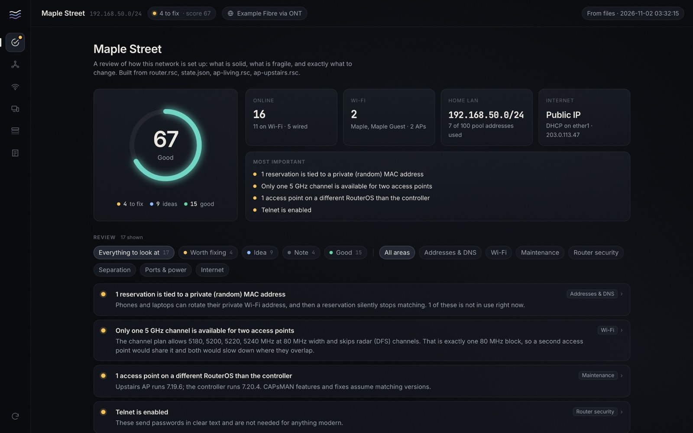

# Stribog

A calm, honest control room for MikroTik home networks.

Stribog reads a RouterOS router (an `/export`, or the REST API, read-only) and shows you:

- **Review**: how the network is set up, what is solid, what is fragile, and exactly what to change. Every finding explains why it matters in plain words and, where the fix is on the router, gives a RouterOS script to review.
- **Topology**: a tidy map with drawings of the actual kinds of hardware. Port LEDs show link speed, PoE is marked, planned devices are dashed, and Wi-Fi clients orbit their access point at a distance set by signal strength.
- **Wi-Fi**: networks, a channel map per band (including where a planned access point would have to go), and every client on a signal scale.
- **Clients**: everything the router has seen, where it is connected, reservations that no longer match, and devices Stribog is unsure about.
- **LAN & internet**: the internet path (double NAT shows as two NAT hops), networks and DHCP, an address map of the LAN, the router's ports, management services, and the firewall in plain language.
- **Setup & fix plan**: a combined fix script for the findings you pick, and a generator for a clean, opinionated home or small-office setup.

Stribog never changes anything on the router. Scripts are for you to read and paste.




<details><summary>More screens</summary>


</details>

Screenshots show the built-in fictional demo network (`fixtures/demo`).

## Quick start

Requires Node 22+ and pnpm.

```sh
pnpm install
pnpm dev            # http://127.0.0.1:4517, shows the demo network
```

### Your own network, offline

Export the configuration on the router (`/export file=router`, then download `router.rsc`) and do the same on each CAPsMAN access point. Then create `stribog.config.json` in the repository root (it is git-ignored, as is `data/`):

```json
{
  "sources": [
    { "role": "router", "export": "data/router.rsc" },
    { "role": "cap", "export": "data/ap-living.rsc" }
  ],
  "overrides": "data/overrides.json"
}
```

An export has the configuration but no runtime state, so the review works fully while clients, signal and link speeds are missing. A `state` file per source can add runtime data (see `fixtures/demo/state.json` for the shape).

### Your own network, live (read-only)

Create a user that can only read:

```
/user group add name=stribog-read policy=read,api,rest-api,!write,!policy,!sensitive,!ftp,!reboot,!test,!password,!sniff,!romon
/user add name=stribog group=stribog-read password="<long random password>"
```

The REST API is served by the `www-ssl` service (and `www`, plain HTTP, since RouterOS 7.9). Prefer `www-ssl` with a certificate, and restrict the service to the machine running Stribog with `address=`.

```json
{
  "live": { "url": "https://192.168.88.1", "user": "stribog", "passwordFile": "~/.config/stribog/router-password", "insecure": true, "interval": 15 },
  "sources": [{ "role": "cap", "export": "data/ap-living.rsc" }],
  "overrides": "data/overrides.json"
}
```

`insecure` accepts the router's self-signed certificate. The password can also come from `STRIBOG_PASSWORD`. Stribog only issues `GET` requests and `monitor … once` reads.

### Telling Stribog what it cannot know

Names, kinds, rooms, the ISP and planned devices go in the overrides file, keyed by MAC address:

```json
{
  "site": "Home",
  "upstream": { "name": "ISP router", "model": "Example ONT", "isp": "Example Fibre" },
  "devices": {
    "02:00:5E:00:53:10": { "name": "3D printer", "kind": "printer3d", "only24": true, "room": "Workshop" }
  },
  "planned": [{ "id": "ap-2", "name": "Upstairs AP", "kind": "ap", "port": "ether7" }]
}
```

`only24` marks hardware that only has a 2.4 GHz radio, so being on 2.4 GHz is reported as expected rather than as a problem.

## Command line

```sh
pnpm review                                  # terminal report for ./stribog.config.json (or the demo)
pnpm review -- --fix                         # include evidence and fix scripts
pnpm review -- --export router.rsc --cap ap.rsc
pnpm collect -- --url https://192.168.88.1 --user stribog --password-file ~/.config/stribog/router-password --out data/snapshot.json
```

A saved snapshot can be used as a source with `"snapshot": "data/snapshot.json"`.

## Production

```sh
pnpm build && pnpm start      # serves dist/ and /api on 127.0.0.1:4517 (HOST/PORT to change)
```

Stribog has no login of its own. Keep it on localhost, the LAN or a VPN.

## How it works

- `src/core/ros.ts` parses `/export` scripts (line continuations, quoting, `\XX` escapes, `set [ find … ]`) into the same shape the REST API returns, and hides secrets.
- `src/core/model.ts` builds one model of devices, ports, networks, SSIDs, radios and the WAN. Every derived fact records whether it was read, inferred or told by the user, and the UI says "probably" for inferences.
- `src/core/analyze.ts` holds the review rules. `src/core/layout.ts` lays out the topology (port order left to right, so links never cross). `src/core/setup.ts` generates setup scripts, and `src/core/firewall.ts` describes rules in plain language.
- `src/web` is the React app. `src/server` serves `/api/network`.

```sh
pnpm test        # vitest
pnpm typecheck
```

## Status

Early. The live REST path is implemented and unit-tested against a mocked router but has not yet run against real hardware. The setup generator follows RouterOS v7 syntax but should be tried on a spare or freshly reset router before being trusted.

Licence: not chosen yet.
